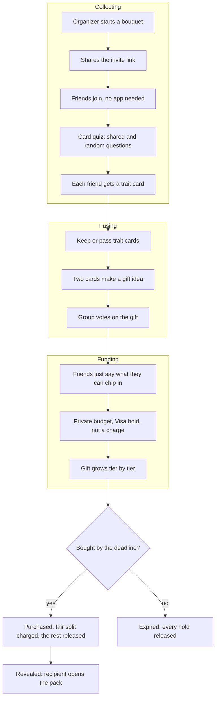
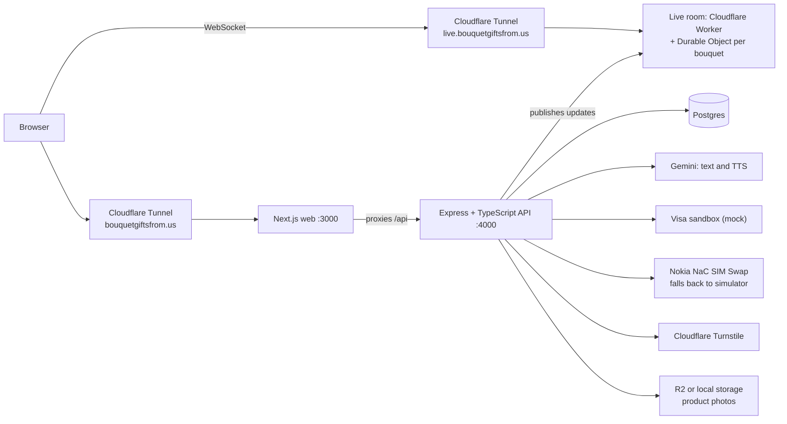
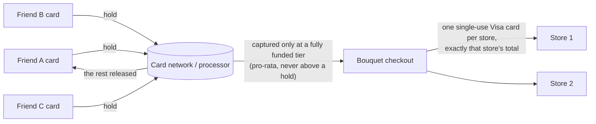

# Bouquet Gifts ✿ — gifts grown by everyone who loves them

**Try it: [bouquetgiftsfrom.us](https://bouquetgiftsfrom.us)** · demo login `demo@bouquet.gift` / `bouquet123` (friends: `jon@`, `priya@`, `sam@bouquet.gift`, same password)

## Inspiration
Every friend group has one person who ends up organizing the gift. They guess what to buy, put it on their own card, and spend three weeks chasing Venmo requests. Meanwhile the rest of the group knows things that would make the gift better ("she's been shooting film all summer"). Group-gift tools only collect money. We wanted to rethink the whole journey: how a group discovers, decides on, pays for and gives a gift.

## What it does
Bouquet is a group gift played as a card game.
- **Start a gift:** set the recipient, the occasion and when it has to arrive. Bouquet works out a **buy-by deadline**.
- **Invite:** the link opens one simple screen on your phone: the gift, how much it costs and who's in, then **Chip in**. No account or app needed.
- **Your card:** each friend answers a short quiz, one question per screen. Everyone gets the same few shared questions, then random ones drawn from a deck, so no two cards are alike. Your answers become a trait card with its own title, like *The Caffeinated Sunrise Hiker*, stat chips like *Sunrise Hiker ×2*, and your own flower on the back. One question, "which gift would annoy them?", quietly rules out bad gifts.
- **Keep, pass, make a gift:** everyone's traits go into one shared deck. Swipe right to keep a card, left to pass. Then drag two kept cards together to make a gift: *Sunrise Hiker + Coffee Snob* becomes a summit pour-over kit. Gift ideas stay face down until the first gift is made, so the deck decides what people see. Cards turn rare when 2 friends agree and legendary at 3, and every gift shows whose cards made it. The gift you make is your vote.
- **Bloom:** each friend sets **their own private budget** and places a **Visa hold**, not a charge. The gift grows in tiers as people join (a pour-over set, then a grinder, then beans), and the bouquet on screen grows with it. Nobody sees anyone else's amount.
- **Change your mind:** take your money back before checkout, or the organizer can cancel and release every hold.
- **Checkout:** holds are charged only up to the highest tier the group fully funded, split fairly, and the rest goes back to each card: *"You paid $30 of your $50 hold · $20 went back to your card."* Each store is paid with a one-time Visa card, so the organizer never touches friends' money. If the deadline passes, everyone gets their money back.
- **Reveal:** the recipient tears open a pack. Each card turns a trait into a compliment ("You chase every sunrise") and a narrator reads each friend's memory aloud, ending in a garland of confetti.
- **Built for phones** and comes with a **Demo tools** drawer for judges: try a declined card, a stolen phone number, skipping past the deadline, or reset the demo.

### The journey

### AI between people and payments (Visa: Reimagine Shopping)
Group payments break down where people talk like people and payment systems want numbers. Bouquet puts Gemini in those gaps, while plain rules own every dollar.
- **Chip in by just saying it, conditions included.** Tap 🎙 and say *"thirty now, forty-two if we get the record"*. Bouquet turns it into a hold and a condition, with a read-back you can take in at a glance. The extra $12 is asked for only if the group goes for that tier. Paydays work too (*"$30, $40 max, I get paid Friday"*).
- **A fair, private top-up.** When the group is a little short, each friend gets their own small ask, sized to what they said they could do: *"$12 more unlocks the Record for Maya."* One tap tops up, after a quick phone security check.
- **"What will I pay?"** Anytime, each friend sees what would happen to their money in three lines: what they'd be charged, what goes back to their card, and why.
- **Gift concierge.** Not sure what to pick? It suggests the gift that fits the most friends' cards and budgets, and says why in one line.

Gemini only does the wording. If its version changes a single dollar amount, Bouquet shows the plain rules version instead.

## How I built it
I built Bouquet with a team of 10 Grok Bot agents: two idea pitchers, an architect, three mock judges, three skeptics, and one builder who wrote and shipped the code.
- **Brainstorming.** The pitchers pitched ideas for the Visa track, the skeptics took them apart, the judges scored them and the architect checked what could be built in a weekend. I picked Bouquet from what survived.
- **Deciding together.** The agents argued and voted on what to build next. I set the direction, added my own asks (flower card backs, private budgets, a buy-by deadline, a real domain) and made the final calls.
- **A loop that ran itself.** Once the app worked, three judges (track fit, UX and demo, payments and business) and three skeptics (a real user, tech and correctness, a devil's advocate) reviewed the live app each round. The builder fixed what they found, pushed and redeployed, and the next round started right away. It ran overnight without me prompting each step.
- **Stopping on time.** The loop stopped early Sunday morning. In the last round, the six critics scored it 84–89 out of 100.

## Tech stack

- **Frontend:** Next.js 14 with hand-drawn SVG and CSS-only animation that stays smooth on a phone.
- **API:** Express + TypeScript on Postgres. Money is stored in whole cents in an append-only ledger, and double taps can never stack holds.
- **Live room:** a Cloudflare Worker with one Durable Object per bouquet, so votes, funding and the reveal show up for everyone instantly.
- **AI:** Google Gemini for card titles, gift pitches, chip-in reading, payment explanations and the reveal narrator (Gemini TTS). Every AI feature also works without it.
- **Catalog:** 130 hand-picked real products from 48 US shops, each linking to its real product page with its real price and photo.
- **Testing:** unit, API and Playwright end-to-end tests, including fuzzing the fair split across 200 cases.
- **What's mocked:** Visa holds, captures and store cards run on a mock Visa sandbox. The SIM Swap check uses a real Nokia Network as Code client, but the live call fails on our deployment, so it falls back to a simulator. Number Verify is mocked. Everything else is live.

### Sponsor tech and tracks
- **Visa: Reimagine Shopping.** AI that bridges people and payments: say-it chip-ins, private top-ups, a "what will I pay?" receipt and a gift concierge, on a mock Visa sandbox.
- **T-Mobile.** A CAMARA SIM Swap check before large holds and checkout, built on Nokia Network as Code (falls back to a simulator here, as noted above).
- **Cloudflare (free tier).** Turnstile, a Worker and Durable Objects for the live room, and a Cloudflare Tunnel serving bouquetgiftsfrom.us.
- **MLH Best Use of Gemini API.** Gemini 2.5 Flash reads chip-ins and writes card titles, pitches and explanations; Gemini TTS narrates the reveal.
- **DubHacks NEXT.** A real problem, a clear first user (the friend who always organizes the gift) and a business model below.
- **MLH Best Domain Name from GoDaddy Registry.** **bouquetgiftsfrom.us**: it's what the recipient gets, a bouquet of gifts from us.
- **MLH Commit Fellowship.** We want to keep building this after DubHacks.

**Built with:** nextjs · react · typescript · cloudflare-turnstile · cloudflare-workers · durable-objects · websockets · express · postgresql · pglite · cloudflare-tunnel · docker · playwright · vitest · google-gemini · gemini-tts · camara · t-mobile · visa

## Challenges we ran into
- **Agents agree with each other too easily.** Judges alone were too kind, so the team needed three skeptics with different angles: a real user, a tech and correctness checker, and a devil's advocate.
- **Critics weren't always right.** Every finding had to be checked against the real code and the live site before the builder acted on it.
- **Docs kept drifting from the code.** With fixes shipping all night, the write-up fell behind, so every round also checked the docs against the app.
- **Splitting money fairly in whole cents.** Each friend's share can never exceed their hold, and the total has to match the price to the cent.

## Accomplishments that we're proud of
- **A review loop that ran all night on its own.** Six critics reviewed the live app each round and the builder shipped fixes, while I set direction and made the final calls.
- **The critics caught real bugs:** money totals that didn't add up, a demo clock that let anyone expire every gift, a double-tap error, and a way to guess a friend's private budget.
- **A finished product:** from invite to reveal, no single friend ever fronts the money. All six critics scored the final version 84–89 out of 100.

## What we learned
- **Agents need disagreement.** A team of agents that all agree is no better than one; different points of view caught what the others missed.
- **Trust, but verify.** An agent's claim is only a lead until you check it against the code.
- **A human still steers.** The agents moved fast, but deciding what mattered was my job.
- **AI belongs at the edges of a payment,** understanding what people say and explaining what happened, while plain rules own every number.

## What's next for Bouquet Gifts
Voice interviews with Gemini Live, real Visa holds once sandbox credentials are available, payday reminders ("you said you get paid Friday, want to top up?"), live catalog prices, and letting friends choose whether their memory is read aloud.

### Business model / revenue (DubHacks NEXT)
- **Group gift fee:** a small fee (we plan 4%) charged only when a gift is actually bought. A $150 gift earns about $6.
- **Merchant referrals:** a group that has agreed and funded is a near-certain sale, so stores pay affiliate fees (typically 5–10%) and, later, clearly labelled sponsored spots.
- **Teams and companies:** office birthdays and farewells, with a manager-funded base tier and expense-ready receipts, priced per seat.
- **First users:** college friend groups, then campus clubs, then small startup teams.

### How it compares
- **Venmo or Cash App requests:** one person still picks the gift and chases the money.
- **Group cards and collection sites** (GroupTogether, Kudoboard): a pot of money that isn't tied to a gift.
- **Wishlists** (Elfster, Giftster): they coordinate who buys what, but each person still pays alone.
- **Bouquet:** friends pick the gift together, each keeps a private budget, and money is only held, never charged, until the group buys.

## How the money moves

Holds that aren't needed go back to each friend's card, and each store is paid exactly what it's owed.
